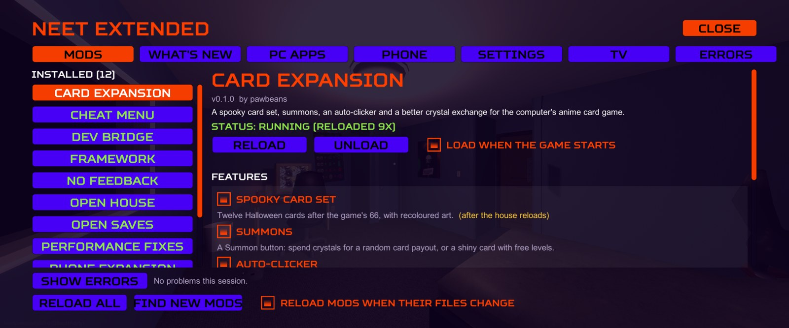
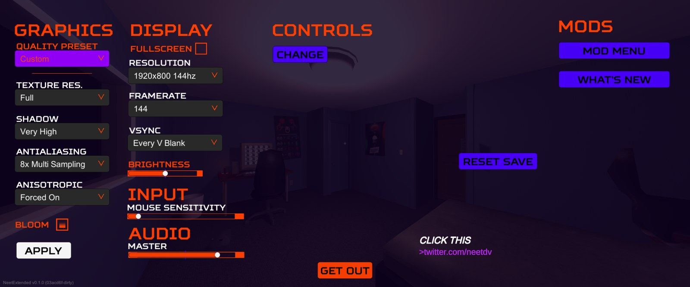
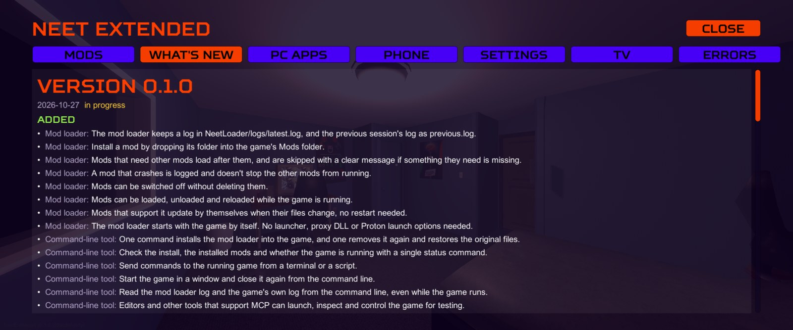

<div align="center">

# NeetExtended

Mods, a mod loader and modding tools for [NEET Demo](https://store.steampowered.com/app/2054460/).

[](LICENSE)
[](https://github.com/Official-Husko/NeetExtended/releases)
[](https://github.com/Official-Husko/NeetExtended/releases)
[](https://github.com/Official-Husko/NeetExtended/stargazers)
[](https://github.com/Official-Husko/NeetExtended/commits)
<br>
[](https://store.steampowered.com/app/2054460/)
[](compat/game.json)
-4a4a4a)




</div>

## What you get

| Mod | What it does |
| --- | --- |
| **Unofficial NEET Patches** | Fixes bugs in the game: saves that stop working, put-out fires that come back after loading, story events stuck in a loop, status effects that never wear off, frame rate and vsync settings that reset themselves, an empty inbox and repeating spam after loading, and more. |
| **Performance Fixes** | Saving without the freeze, no more video memory piling up on every load, the front door's peephole camera only running near the door, a shadow setting, less log spam. Experimental. |
| **Phone Expansion** | Over 60 new calls and 18 numbers to dial: pizza delivery, Spookbusters, a deal with Satan, hotlines, telemarketers, kids prank calling you, and a few you'd rather not answer. |
| **Email Expansion** | About 70 new emails in the computer's inbox that you can answer: scams, mom, cults, bills, creeps. Replies can pay you, cost you, or send something to your door. |
| **Custom TV Stations** | Your own videos (MP4 or WebM) on the living room TV. |
| **Randomizer** | A seed per save shuffles who knocks at night, store prices, deliveries, the house on a new game and how fast you get hungry. |
| **Mixtapes** | Your own music (OGG, MP3 or WAV) on cassettes for the radio, and as the radio's station when there's no tape in. |
| **Update Checker** | Checks once at start and then every hour whether a newer version is out, and says so in the corner. If you let it, the game also nags you about it by email and phone. |
| **Open House** | Opens the pantry, the basement backroom, dad's yard, and if you want the attic and the roof. |
| **Card Expansion** | Twelve Halloween cards, summons, an auto-clicker and a better crystal exchange for the computer's card game. |
| **Pumpkin Smash** | A whack-a-pumpkin game on the in-game computer. |
| **Open Saves** | Saves about 16 times smaller and a save folder that doesn't fill up. |
| **Cheat Menu** | Press Insert: god mode, needs, money, spawning, fire, power, doors, game speed. |
| **No Feedback** | Stops the pause menu from sending feedback reports from a modded game. |

Everything can be switched on and off in game, mod by mod and feature by feature. [FEATURES.md](FEATURES.md) has the full list with every switch and setting.

<table>
  <tr>
    <td></td>
    <td></td>
  </tr>
  <tr>
    <td align="center">MODS in the pause menu</td>
    <td align="center">What's New, built from the commit history</td>
  </tr>
</table>

## Installing

You need NEET Demo from Steam, on Windows or on Linux through Proton.

1. Download the latest `NeetExtended-<version>.zip` from [Releases](https://github.com/Official-Husko/NeetExtended/releases) and unpack it anywhere.
2. Close the game.
3. Run `install.bat` on Windows or `install.sh` on Linux.
4. Start the game from Steam. **F1** (or MODS in the pause menu) opens the mod menu.

The installer finds the game through Steam. If it doesn't, pass the folder: `install.sh --game "/path/to/steamapps/common/NEET Demo"`.

It asks two things:

- **Switch to 64-bit?** Downloads Unity's 64-bit player for the game's exact Unity version straight from Unity (about 180 MB) and swaps it in. Slightly faster, more memory. The 32-bit files are kept, so you can switch back.
- **Incremental garbage collection?** Memory gets cleaned up a little every frame instead of all at once, which gets rid of the short freezes. Recommended.

Each release is tested with a specific build of the game; the **game compatibility** badge at the top shows whether that's still Steam's current build. If the game updates, the mods tell you in the corner of the screen and usually keep working until a tested release follows.

Running the installer again updates the mods and keeps your settings. `uninstall.bat` / `uninstall.sh` put the game back the way it was; your saves stay.

## Building from source

You need the [.NET 10 SDK](https://dotnet.microsoft.com/download) and the game installed through Steam (the build references the game's own assemblies, nothing from the game is in this repo).

```sh
git clone https://github.com/Official-Husko/NeetExtended.git
cd NeetExtended
dotnet build NeetMods.sln -c Release           # builds everything and copies the mods into the game
dotnet run --project tools/NeetTool -- install # once: hook the loader into the game
dotnet run --project tools/NeetTool -- launch  # start the game in a window
```

If the game isn't in your main Steam library, set `NEET_GAME_DIR` or put a `<NeetGameDir>` in `build/Local.props`.

With the game running, rebuild and the changed mods reload by themselves within a second or so. `build/package.sh` makes the release zip and `build/release.sh` publishes a release ([how](docs/modding/tools.md#release)).

Writing your own mod? Start with [getting started](docs/modding/getting-started.md). The rest of the guides are in [docs/](docs/README.md), along with notes on how the game's code works.

## How it's put together

| Part | |
| --- | --- |
| [`src/NeetLoader`](src/NeetLoader) | The loader. It starts with the game through Unity's own startup files, so there's no launcher, proxy DLL or Proton launch option. Loads, unloads and hot reloads mods while the game runs. |
| [`src/NeetModKit`](src/NeetModKit) | The framework mods build on: game access, events, items, dialogue in the game's own Ink story, save data, the card game, computer apps, UI built from the game's menus, switchable features, and the mod menu. |
| [`mods/`](mods) | The mods, one folder each. |
| [`mods/DevBridge`](mods/DevBridge) | A local socket for testing: read and change game state, spawn things, profile, take screenshots. Not part of the release. |
| [`tools/NeetTool`](tools/NeetTool) | `neet`, the command-line tool: install, launch, logs, the bridge, save conversion, the changelog, and an MCP server. |

## Bugs and ideas

Open an [issue](https://github.com/Official-Husko/NeetExtended/issues). For a bug, the mod menu's **Errors** tab has a **COPY REPORT** button; paste that in (it's also saved as `NeetLoader/logs/errors.log` in the game folder). [TODO.md](TODO.md) has what's planned. Pull requests are welcome.

## License

[GPL-3.0](LICENSE).

NeetExtended is a fan project, not affiliated with the makers of NEET. It contains none of the game's files; you need your own copy of NEET Demo.

## Star history

<a href="https://star-history.com/#Official-Husko/NeetExtended&Date">
  <picture>
    <source media="(prefers-color-scheme: dark)" srcset="https://api.star-history.com/svg?repos=Official-Husko/NeetExtended&type=Date&theme=dark">
    
  </picture>
</a>
